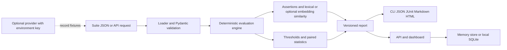

# DriftGuard Pro

Deterministic regression and drift detection for LLM applications.

DriftGuard compares **baseline** responses with **candidate** responses (after a prompt, model,
provider or code change) using saved JSON fixtures, so the core workflow needs **no API keys and
no paid API calls**. It reports PASS / FAIL / ERROR / INCONCLUSIVE per test and per suite, tracks
drift in text, JSON structure, latency, tokens and cost, and ships a CLI, a FastAPI backend and a
small web dashboard.

## Install

Requires Python 3.11 or 3.12.

```bash
python -m venv .venv
```

Windows (PowerShell / cmd):

```bat
.venv\Scripts\activate
```

Linux / macOS:

```bash
source .venv/bin/activate
```

Then:

```bash
python -m pip install -e ".[dev]"
pytest -q
driftguard --help
driftguard run examples/demo.json
uvicorn driftguard.api:app --reload
```

Open <http://127.0.0.1:8000/> for the dashboard and <http://127.0.0.1:8000/docs> for the API docs.
`driftguard serve` is an equivalent shortcut that starts the same app without auto-reload.

Optional extras: `".[openai]"`, `".[anthropic]"`, `".[embeddings]"` (sentence-transformers).
Runtime-only install (no test/lint tools): `python -m pip install .`.

## Quick start

```bash
driftguard run examples/demo.json                 # all pass            -> exit code 0
driftguard run examples/regression.json           # simulated regression -> exit code 1
driftguard compare examples/baseline.json examples/candidate.json --suite examples/demo.json
driftguard run examples/demo.json --out-dir reports      # writes JSON + HTML reports
driftguard report reports/demo-support-bot.report.json --format html -o demo.html
driftguard simulate examples/simulator.json -o my-suite.json   # seeded, deterministic
driftguard validate examples/*.json               # lint suites without running them
driftguard diff old.report.json new.report.json   # which cases regressed since last run?
driftguard schema suite > suite.schema.json       # JSON Schema for editor autocompletion
```

### Use it in CI

```yaml
- run: pip install driftguard-pro
- run: driftguard run suites/ --out-dir reports --formats json,junit,md
- run: cat reports/*.report.md >> "$GITHUB_STEP_SUMMARY"      # human-readable summary
- run: driftguard diff baseline/my-suite.report.json reports/my-suite.report.json
```

The baseline must be present; a missing or unreadable report exits with code 2 and fails the job.
For a self-contained gate, write the baseline and candidate to separate directories, then compare
them with `driftguard diff baseline/my-suite.report.json candidate/my-suite.report.json`. The gate
exits 0 when no cases regress, 1 for a regression or removed case, and 2 for invalid or incompatible
reports. CI runs `python scripts/regression_gate_demo.py`, which verifies healthy, acceptable, and
degraded results and JSON/JUnit/Markdown output using synthetic data without provider credentials.

`junit.xml` files plug into the test-report views of GitHub, GitLab and Jenkins.

Run the complete offline gate demonstration locally:

```bash
python scripts/regression_gate_demo.py
```

It uses the synthetic suites in `examples/regression-gate/`, generates JSON/JUnit/Markdown
reports, checks that the acceptable candidate passes, and verifies that the degraded candidate
fails with assertion, similarity, and latency reasons. It uses no provider, credential, or network.

### Exit codes

| Code | Status | Meaning |
|------|--------|---------|
| 0 | PASS | every check passed |
| 1 | FAIL | an assertion or drift threshold failed |
| 2 | ERROR | unreadable/malformed file, invalid config, missing candidate, usage error |
| 3 | INCONCLUSIVE | nothing could be verified (empty suite, or cases with neither assertions nor a baseline) |

When several suites or cases are combined the worst status wins:
`ERROR > FAIL > INCONCLUSIVE > PASS`. A failure to load one suite is reported as ERROR but the
remaining suites still run.

## Suite format

```json
{
  "name": "my-suite",
  "thresholds": { "min_similarity": 0.8, "max_latency_increase_pct": 50,
                  "max_token_increase_pct": 50, "max_cost_increase_pct": 50,
                  "fail_on_json_structure_change": true, "fail_on_json_value_change": false },
  "cases": [
    {
      "id": "order_status",
      "prompt": "Return the order status as JSON.",
      "weight": 3,
      "assertions": [
        {"type": "json_keys", "keys": ["status", "eta_days"]},
        {"type": "json_schema", "schema": {"type": "object", "required": ["status"]}}
      ],
      "baseline":  {"text": "{\"status\": \"shipped\", \"eta_days\": 3}", "latency_ms": 380,
                    "prompt_tokens": 22, "completion_tokens": 12, "cost_usd": 0.000068},
      "candidate": {"text": "{\"status\": \"shipped\", \"eta_days\": 3}", "latency_ms": 395,
                    "prompt_tokens": 22, "completion_tokens": 12, "cost_usd": 0.000068}
    }
  ]
}
```

* **Assertions** run on the candidate: `exact_match` (`expected`, `strip`, `case_sensitive`),
  `non_empty`, `contains` / `not_contains` (`value`, `case_sensitive`), `length` (`min`/`max`
  characters), `json_keys` (dotted paths such as `user.name` are supported) and `json_schema`
  (JSON Schema; remote `$ref`s are never fetched).
* **Drift** is computed when a case has a baseline. A case FAILs when text similarity is below
  `min_similarity` (per-case override: `min_similarity`), when JSON structure changed (keys
  added/removed, type changes, JSON became invalid), or when latency/tokens/cost grew beyond the
  configured percentage. Metrics missing on either side are skipped. A zero baseline cannot
  produce a percentage, so no limit is applied.
* **Report diff** requires the same suite name and suite version and a supported report schema.
  Regressed statuses, newly added failing/error/inconclusive cases, and removed cases fail the
  gate; improvements and added passing cases do not. Compare reports generated with the same
  suite semantics and thresholds.
* **Case status**: `ERROR` (missing candidate, invalid assertion config such as a bad schema) >
  `FAIL` > `INCONCLUSIVE` (no assertions and no baseline) > `PASS`.
* **Fixtures** for `compare` look like `{"name": "...", "responses": {"<case id>": {"text": "..."}}}`.
  `driftguard record` can create them from a live provider.

## Statistics: what is and is not claimed

For every metric with paired data (latency, total tokens, cost) the report gives the weighted
mean baseline/candidate/difference, a **percentile bootstrap confidence interval** (paired
differences, fixed seed, default 95 %, 2000 resamples) and a **paired sign-flip randomization
test** (two-sided; exact enumeration for n ≤ 12 pairs, otherwise a seeded Monte Carlo test).

* `significant` is `true`/`false` only when that test actually ran (at least `min_pairs` = 6 pairs)
  and is `null` ("not tested") otherwise. No significance claim is ever made without it.
* p-values are **not** corrected for testing several metrics; the report says so.
* Text similarity gets a bootstrap CI of its weighted mean but no hypothesis test.
* Case verdicts (PASS/FAIL) come only from deterministic thresholds, never from p-values.
* The same seed and inputs always give identical numbers (`--seed`, default 0).
* For very large suites the resample count is reduced so that `n * resamples <= 4,000,000`
  (never below 200); the report states the reduction in the metric's note.

## Similarity

`lexical_similarity` (default) blends multiset-token Jaccard and token-sequence ratio, ignores
case/whitespace, and returns **exactly `1.0` for identical text**. Two empty strings → `1.0`;
empty vs. non-empty → `0.0`; non-`str` input raises `InvalidInputError`.
Above 2,000 tokens the order-sensitive component switches from `SequenceMatcher` (super-linear)
to a linear bigram overlap, so a 20k-token comparison takes milliseconds instead of seconds.
`--similarity embedding` uses cosine similarity from sentence-transformers (extra
`embeddings`; model via `DRIFTGUARD_EMBEDDING_MODEL`, default `all-MiniLM-L6-v2`, which is
downloaded on first use). Without the extra you get a clear ERROR, never a silent fallback.

## Simulator

`driftguard simulate examples/simulator.json -o suite.json` generates baseline/candidate responses
with weighted cases and injectable regressions (`text_drift`, `latency`, `tokens`, `cost`,
`json_break`, `empty`, each with a probability, magnitude and optional `case_ids`). Every random
choice is derived from `sha256(seed:case_id:role)`, so runs are identical for the same seed and
independent of case order. `examples/regression.json` is exactly the output for the shipped config
(a test enforces this).

## Providers (optional)

`driftguard record suite.json --provider openai --model <model> -o fixtures.json`
(or `--provider anthropic`). Keys are read **only** from `OPENAI_API_KEY` / `ANTHROPIC_API_KEY`,
are never stored, logged or included in errors, and no model or price is hardcoded: pass
`--model`, and `--price-in/--price-out` (USD per 1M tokens) if you want cost tracking. SDK requests
have retries disabled and a 30-second timeout by default; set `DRIFTGUARD_PROVIDER_TIMEOUT` to a
value from 0.1 to 300 seconds to change it. Provider calls are optional and may incur charges.

## API

| Method & path | Purpose |
|---------------|---------|
| `GET /api/health` | liveness + version |
| `GET /api/examples` | bundled example suites (`demo`, `regression`) |
| `POST /api/runs` | run `{"suite": {...}}` or `{"example": "demo"}` (+ optional `config`) |
| `GET /api/config` | `{version, auth_required, persistent}` (public) |
| `GET /api/runs?limit&offset&suite` | list runs, newest first (limit 1-200) |
| `GET /api/runs/{id}` / `DELETE /api/runs/{id}` | full report / delete |
| `GET /api/runs/{id}/failures` | non-passing cases |
| `GET /api/runs/{id}/report?format=json\|html\|junit\|md` | downloadable report |
| `GET /api/diff?old=ID&new=ID` | regressions, fixes, added/removed cases |
| `GET /api/trends?suite=NAME&limit` | pass-rate history of one suite, oldest first |
| `POST /api/compare` | `{"baseline": fixtures, "candidate": fixtures, "suite"?: suite}` |
| `POST /api/simulate` | `{"config": simulator config, "run": false}` |

Inputs are validated with Pydantic (422 on invalid input, 404 for unknown runs/examples, 400 for
domain errors, 413 for oversized bodies, 401 without a valid token, generic 500 without internals).

* **Persistence:** by default the last 200 runs live in memory. Set `DRIFTGUARD_DB=./runs.db`
  (or `driftguard serve --db runs.db`) to keep them in a SQLite file (stdlib `sqlite3`,
  parameterized queries, WAL mode).
* **Auth:** set `DRIFTGUARD_API_TOKEN` (at least 16 characters) to require
  `Authorization: Bearer <token>` on every `/api/*` route except `/api/health` and
  `/api/config`. Tokens are compared in constant time and never logged. The dashboard asks for
  the token and keeps it in `sessionStorage` only. This is a single shared secret, not
  user management: use TLS (reverse proxy) when exposing the service.
* **Limits:** request bodies above 10 MiB are rejected (`DRIFTGUARD_MAX_BODY_BYTES`).
  There is no rate limiting; use a proxy for that.

The dashboard seeds itself with the two bundled examples on first load, shows a pass-rate trend
per suite, lets you expand any case (baseline/candidate output, assertion results, metric
deltas, JSON diff), compare any two runs, download JSON/HTML/JUnit/Markdown reports and delete runs.

## Reports

JSON, HTML, JUnit XML and Markdown reports contain run metadata (version, run id, suite SHA-256, config, thresholds),
per-case results with failure reasons, and summary statistics. Reports are reproducible: the run id
is a hash of suite + config, and `generated_at` honours `SOURCE_DATE_EPOCH`
(e.g. `SOURCE_DATE_EPOCH=0 driftguard run ... --out-dir r` gives byte-identical files).

## Security notes

* No user-provided code is ever executed (no `eval`/`exec`; assertions are declarative).
* JSON Schema `$ref`s are not resolved over the network.
* Secrets: environment variables only; log output passes through a redacting formatter.
* The API serves the dashboard with a strict Content-Security-Policy; the dashboard builds DOM
  with `textContent` only, and HTML reports escape all content.
* Very large or deeply nested inputs are rejected (25 MB file limit, 1M-character text limit).
  Pathological JSON-Schema regexes can still be slow; treat suites from untrusted sources accordingly.

## Docker

```bash
docker build -t driftguard-pro .
docker run --rm -p 8000:8000 -v driftguard-data:/data driftguard-pro
# with auth:   -e DRIFTGUARD_API_TOKEN="$(python -c 'import secrets;print(secrets.token_urlsafe(32))')"
```

Runs are stored in `/data/driftguard.db` (the `driftguard-data` volume).

## Development

```bash
python -m pip install -e ".[dev]"
ruff check . && ruff format --check .
mypy
pytest -q --cov
python benchmarks/benchmark_core.py
```

The benchmark prints the Python version, platform, suite sizes (100/1,000/5,000 cases), text sizes
(500/2,000/20,000 tokens), elapsed time, and peak Python-traced allocation per workload (not total
process RSS). Treat results as machine-specific; the script does not impose timing thresholds.

CI (`.github/workflows/ci.yml`) runs lint, mypy and tests on Python 3.11/3.12 on Ubuntu and
Windows, plus a CLI smoke test and a Docker build.

Property-based tests (Hypothesis) check invariants such as "identical text scores exactly 1.0",
CI ordering/determinism and "the engine and every renderer never crash on arbitrary input".
`tests/data/report_v1_0_*.json` are real reports from 1.0 and guard backwards compatibility.
Coverage must stay above 90 % (`fail_under` in `pyproject.toml`). See also
[CHANGELOG.md](CHANGELOG.md) and [MIGRATION.md](MIGRATION.md).

## Architecture



Core evaluation, the simulator, SQLite, examples, and CI do not require paid services or outbound
network access. Optional provider recording sends prompts to the explicitly selected provider.
The package's required runtime dependencies are open source; optional provider and embedding extras
are not installed by the default package install. No license-audit tool result is available for
this source snapshot; review dependency licenses again when locking or publishing distributions.

Note: `examples/` is mirrored in `src/driftguard/examples/` so the API works from an installed
package; `tests/test_examples.py` fails if the two copies diverge.

## Layout

```
src/driftguard/
  models.py  assertions.py  similarity.py  stats.py  jsonutil.py  drift.py  diff.py
  engine.py  simulator.py   reports.py     loader.py store.py      logging_utils.py errors.py
  cli.py     api.py         providers/     dashboard/ examples/
tests/  examples/  .github/workflows/  Dockerfile  pyproject.toml
```

## License

MIT
